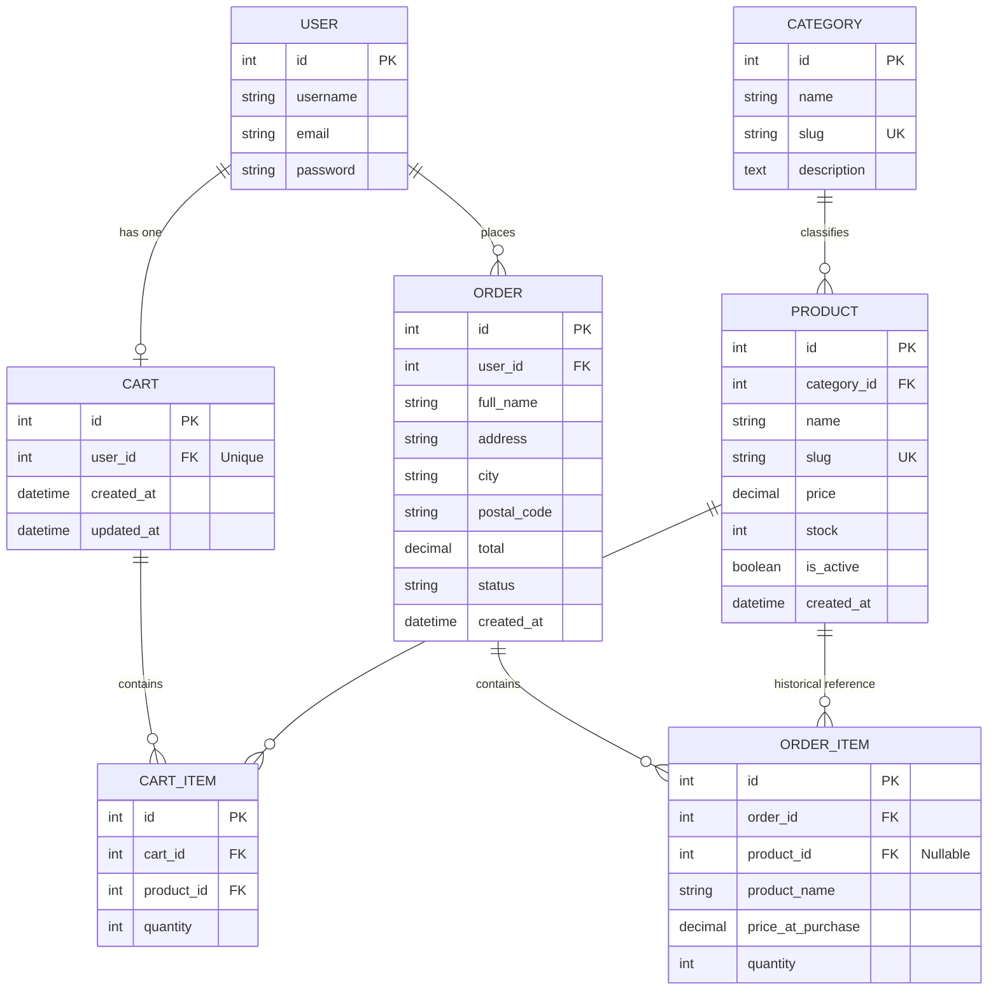
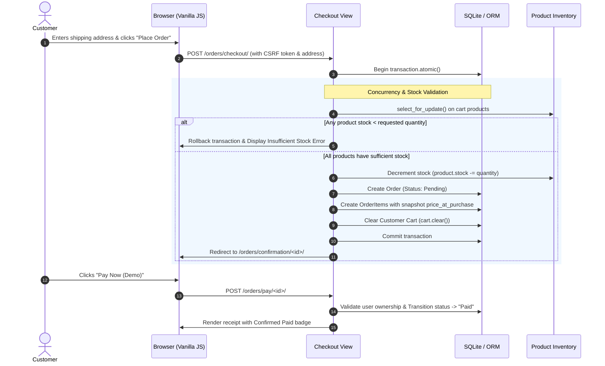

<<<<<<< HEAD
# SwiftShop - Simple Full-Stack E-Commerce Store

SwiftShop is a complete, production-ready, modular e-commerce store built with **Django 5 (Python 3.12)**, **Django ORM**, **SQLite**, and modern **Bootstrap 5 + Vanilla JavaScript**. Designed specifically for interview showcases, college vivas, and architectural demonstrations.

---

## Table of Contents
1. [Tech Stack](#tech-stack)
2. [Key Features](#key-features)
3. [Project Folder Tree](#project-folder-tree)
4. [Entity-Relationship (ER) Diagram](#entity-relationship-er-diagram)
5. [How It Works: Atomic Checkout Flow](#how-it-works-atomic-checkout-flow)
6. [Step-by-Step Setup & Run Instructions](#step-by-step-setup--run-instructions)
7. [Default Demo Accounts](#default-demo-accounts)
8. [Running Unit Tests](#running-unit-tests)
9. [Screenshots](#screenshots)
10. [Viva & Technical Interview Q&A](#viva--technical-interview-qa)

---

## Tech Stack
- **Backend**: Django 5.1+ (Python 3.11+ / 3.12), Django ORM, SQLite database
- **Frontend**: Django Templates, HTML5, CSS3, Vanilla JavaScript (ES6+ `fetch`), Bootstrap 5.3 (via CDN), Bootstrap Icons
- **Image Processing**: Pillow 13.0+
- **Environment Management**: python-dotenv with `.env` separation
- **No Paid External Services**: Zero payment gateway charges. Includes full simulated demo checkout & payment settlement.

---

## Key Features

1. **User Authentication & Profiles (`accounts`)**:
   - Custom registration form validating username, email uniqueness, password confirmation, and minimum length.
   - User login with safe `next` URL redirection.
   - Safe POST logout.
   - Clear field validation feedback and dismissible flash messages.

2. **Catalog & Search (`store`)**:
   - Responsive product grid with badges for stock availability.
   - Instant search by product name and description (`Q` objects).
   - Category filtering pills with active state indicators.
   - Server-side pagination (strictly **8 products per page** as required).

3. **Product Detail Page (`store`)**:
   - Large product image preview.
   - Comprehensive description, pricing, and stock counter.
   - Interactive quantity selector (+ / - / manual input capped at stock limit).
   - "Related Products" recommendation carousel.

4. **Interactive Shopping Cart (`cart`)**:
   - Persistent database-backed cart tied to authenticated users.
   - Real-time **Vanilla JavaScript AJAX** quantity increase, decrease, and item deletion without page reloads.
   - Graceful non-JS fallback (standard HTML forms and buttons work even if JavaScript is disabled).
   - Live badge counter in navbar synchronized across requests via a custom Django Context Processor.
   - Empty state illustration with CTA to start shopping.

5. **Concurrency-Safe Atomic Checkout (`orders`)**:
   - Shipping destination form (full name, address, city, postal code).
   - Single atomic transaction (`transaction.atomic()`).
   - Row-level lock (`select_for_update()`) on products during checkout to eliminate race conditions and overselling.
   - Immediate stock decrement upon purchase.
   - Automatic cart clearing upon successful order placement.

6. **Payment Simulation & Receipts (`orders`)**:
   - Instant "Pay now (demo)" button simulating payment gateway callback and updating status from `Pending` to `Paid`.
   - Printable order receipt with item breakdown and unit price at time of purchase.
   - "My Orders" order history page with security isolation (users can only access their own orders).

7. **Django Admin Management**:
   - Comprehensive administration dashboard for `Categories`, `Products` (with inline editing of price and stock), `Carts`, and `Orders`.
   - Order status management: `Pending`, `Paid`, `Shipped`, `Delivered`, `Cancelled`.

---

## Project Folder Tree

```text
ecommerce/
├── .env                              # Local environment secrets (DEBUG, SECRET_KEY, ALLOWED_HOSTS)
├── .env.example                      # Template environment file
├── .gitignore                        # Git exclusion rules
├── db.sqlite3                        # Local SQLite database (auto-generated)
├── manage.py                         # Django CLI entrypoint
├── requirements.txt                  # Python dependencies
│
├── ecommerce_project/                # Project Configuration
│   ├── __init__.py
│   ├── asgi.py
│   ├── settings.py                   # Main settings, apps, context processors, message tags
│   ├── urls.py                       # Root URL routing + media serving
│   └── wsgi.py
│
├── accounts/                         # User Auth App
│   ├── admin.py
│   ├── apps.py
│   ├── forms.py                      # CustomUserCreationForm & LoginForm
│   ├── models.py
│   ├── tests.py                      # Auth & validation unit tests
│   ├── urls.py                       # /accounts/register/, /login/, /logout/
│   └── views.py                      # Registration, login, logout controllers
│
├── store/                            # Product & Catalog App
│   ├── admin.py                      # CategoryAdmin & ProductAdmin with search/filter
│   ├── apps.py
│   ├── models.py                     # Category & Product models
│   ├── tests.py                      # Catalog, search, filter, pagination tests
│   ├── urls.py                       # /, /product/<slug>/
│   ├── views.py                      # product_list & product_detail
│   └── management/
│       └── commands/
│           ├── __init__.py
│           └── seed_db.py            # Generates 15 products, 3 categories, images, and demo users
│
├── cart/                             # Persistent Shopping Cart App
│   ├── admin.py                      # CartAdmin with CartItemInline
│   ├── apps.py
│   ├── context_processors.py         # Injects cart_item_count globally into all templates
│   ├── models.py                     # Cart & CartItem models
│   ├── tests.py                      # Add to cart, quantity update, AJAX tests
│   ├── urls.py                       # /cart/, /cart/add/, /cart/update/, /cart/remove/
│   └── views.py                      # Cart operations with AJAX and fallback
│
├── orders/                           # Checkout & Order Processing App
│   ├── admin.py                      # OrderAdmin with OrderItemInline & status editor
│   ├── apps.py
│   ├── forms.py                      # CheckoutForm
│   ├── models.py                     # Order & OrderItem models
│   ├── tests.py                      # Atomic checkout, stock validation & isolation tests
│   ├── urls.py                       # /orders/checkout/, /pay/, /confirmation/, /my-orders/
│   └── views.py                      # Atomic checkout, payment simulation, order history
│
├── media/                            # User & Seed Uploaded Assets
│   └── products/                     # Auto-generated product PNG images
│
├── static/                           # Static Assets
│   ├── css/
│   │   └── style.css                 # Custom modern stylesheet
│   ├── js/
│   │   └── cart.js                   # Vanilla JS AJAX cart updater
│   └── images/
│       └── placeholder.svg           # Scalable SVG fallback image
│
└── templates/                        # Global HTML Templates
    ├── 404.html                      # User-friendly 404 error page
    ├── base.html                     # Master layout (navbar, cart badge, alerts, footer)
    ├── accounts/
    │   ├── login.html
    │   └── register.html
    ├── store/
    │   ├── product_list.html         # Grid, category pills, search bar, pagination
    │   └── product_detail.html       # Large image, description, stock, quantity selector
    ├── cart/
    │   └── cart_detail.html          # Cart table, live totals, empty state
    └── orders/
        ├── checkout.html             # Shipping form + order summary sidebar
        ├── order_confirmation.html   # Receipt + "Pay now (demo)" button
        ├── order_detail.html         # Individual order receipt
        └── order_history.html        # "My Orders" tracking list
```

---

## Entity-Relationship (ER) Diagram



---

## How It Works: Atomic Checkout Flow

Understanding the checkout workflow is critical for viva presentations. Here is the step-by-step lifecycle of an order:



### Key Technical Safeguards:
1. **`transaction.atomic()`**: Wraps order creation, stock deduction, and cart clearing. If any step fails, all changes are rolled back automatically.
2. **`select_for_update()`**: Prevents race conditions where two customers attempt to purchase the last available item simultaneously.
3. **Historical Price Snapshot**: The `OrderItem` stores `price_at_purchase` and `product_name`. If product prices change later in the admin, existing customer receipts remain accurate.
4. **User Order Isolation**: All order views query with `user=request.user`. Attempting to access an order belonging to another user returns a `404 Not Found`.

---

## Step-by-Step Setup & Run Instructions

### 1. Prerequisites
- Python 3.11+ or 3.12+ installed on your machine.
- Git (optional, for version control).

### 2. Set Up Virtual Environment

**Windows (PowerShell):**
```powershell
python -m venv .venv
.\.venv\Scripts\Activate.ps1
```

**macOS / Linux:**
```bash
python3 -m venv .venv
source .venv/bin/activate
```

### 3. Install Dependencies
```bash
pip install -r requirements.txt
```

### 4. Configure Environment Variables
Copy `.env.example` to `.env` (already created with safe development defaults):
```bash
# Windows
copy .env.example .env

# macOS / Linux
cp .env.example .env
```

### 5. Apply Database Migrations
```bash
python manage.py migrate
```

### 6. Seed Sample Data (Categories, Products, Images, & Accounts)
Run the built-in seeding management command:
```bash
python manage.py seed_db
```
*This seeds 15 products across 3 categories, generates high-quality PNG product banners in `media/products/`, and creates the demo user accounts.*

### 7. (Optional) Create Custom Superuser
If you wish to create your own administrative credentials:
```bash
python manage.py createsuperuser
```

### 8. Run Development Server
```bash
python manage.py runserver
```
Visit your store in the browser at: **[http://127.0.0.1:8000/](http://127.0.0.1:8000/)**

---

## Default Demo Accounts

| Role | Username | Password | Purpose |
| :--- | :--- | :--- | :--- |
| **Administrator** | `admin` | `admin123` | Access Django Admin at `/admin/` to manage inventory, categories, orders |
| **Demo Customer** | `customer` | `customer123` | Test shopping, AJAX cart additions, atomic checkout, and payment simulation |

---

## Running Unit Tests

SwiftShop includes 23 comprehensive automated unit tests covering registration, authentication validation, catalog search, pagination, AJAX cart operations, atomic checkout, stock reduction, and security isolation.

Run all tests:
```bash
python manage.py test
```

Run tests per application:
```bash
python manage.py test accounts
python manage.py test store
python manage.py test cart
python manage.py test orders
```

---

## Screenshots

*(Placeholder section for your viva report or presentation slides)*

| Page | Description | Image Placeholder |
| :--- | :--- | :--- |
| **Product Catalog** | 8-item grid, category filter pills, search input, and cart count in navbar | `[Catalog Screenshot Placeholder]` |
| **Product Detail** | High-res image, stock status indicator, quantity selector, related items | `[Product Detail Screenshot Placeholder]` |
| **Interactive Cart** | Real-time AJAX quantity increment/decrement, line subtotals, order summary | `[Cart Screenshot Placeholder]` |
| **Checkout Page** | Shipping address form, price breakdown, atomic guarantee callout | `[Checkout Screenshot Placeholder]` |
| **Order Receipt** | Post-purchase confirmation, "Pay Now (Demo)" simulated payment button | `[Order Receipt Screenshot Placeholder]` |
| **My Orders** | Order history with status badges (Pending, Paid, Shipped, Delivered) | `[Order History Screenshot Placeholder]` |
| **Django Admin** | Inline product inventory management and order status processing | `[Admin Screenshot Placeholder]` |

---

## Viva & Technical Interview Q&A

### Q1: How do you prevent overselling / race conditions during checkout?
> **Answer**: In `orders/views.py`, checkout operations are wrapped in `with transaction.atomic():`. We execute `select_for_update()` when fetching products in the cart. This puts a row-level lock on the product table for those specific items, ensuring that two concurrent checkouts cannot read and decrement the same stock simultaneously. If stock is insufficient, an exception is thrown, rolling back the database transaction.

### Q2: Why use a custom Context Processor for the cart?
> **Answer**: `cart.context_processors.cart_context` exposes `cart_item_count` and `cart_total_price` globally to `base.html`. Without this, every single view would have to manually fetch the user's cart and pass it into the template context, violating the DRY (Don't Repeat Yourself) principle.

### Q3: How does the AJAX cart maintain graceful degradation?
> **Answer**: Every cart control (add, increment, decrement, delete) is wrapped inside a valid HTML `<form method="post">` containing a CSRF token. JavaScript intercepts the submit event via `event.preventDefault()` and uses `fetch()`. If JavaScript is disabled or fails to load, the browser natively submits the POST request, and Django returns a standard HTTP redirect with updated session state.

### Q4: How is security maintained across user orders?
> **Answer**: Every order query filters by `user=request.user` (e.g., `Order.objects.filter(user=request.user)` and `get_object_or_404(Order, id=order_id, user=request.user)`). If User A guesses User B's order ID (e.g., `/orders/12/`), Django raises an `Http404` rather than exposing another user's data.

### Q5: How are passwords protected?
> **Answer**: We use Django's built-in password management (`make_password`, `check_password`, `User.set_password`), which hashes passwords with **PBKDF2 with a SHA256 digest** and cryptographic salt. No plaintext passwords ever touch the database.
=======
# CodeAlpha_ecomerce
A smart e-commerce and personal shopping platform built with Python, Django, SQLite, HTML, CSS, and JavaScript.
>>>>>>> 15c46e845ea723f82068ef56f31d146d69e8d877
